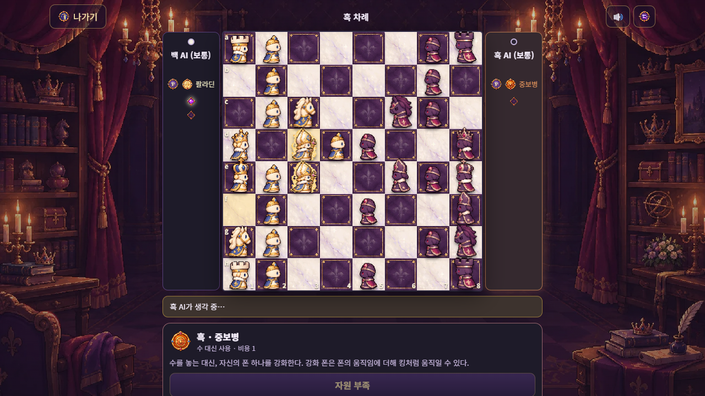

# HyperChess

초능력을 하나 골라 사용하는 2D 체스 게임. 웹 · 모바일 브라우저에서 동작한다.

## 플레이

| 방법 | 내용 |
|---|---|
| **브라우저에서 바로** | https://parkrye.github.io/WebProject_HyperChess/ — AI 대전 · 한 기기 2인 · AI 내전 · 능력 설명 · 리플레이 |
| **Windows 서버판** | [Releases](../../releases)의 `HyperChess-<버전>-windows.zip` 압축 해제 → `play.bat`. 위 전부 + **온라인 대전(방 만들기 · 빠른 매칭)** · 계정 · Elo 랭킹 · 통계. 설치 필요 없음 (Node 포함) |

서버판은 창에 뜨는 `네트워크` 주소로 같은 와이파이의 다른 기기(폰 · 노트북)가 접속해 대전할 수 있다. 처음 실행할 때 Windows 방화벽이 물으면 `개인 네트워크`를 허용. 대국 기록 · 계정은 압축을 푼 폴더의 `app/server/data`에 저장된다.

## 규칙

- 게임 시작 전에 능력을 하나 고른다. 양쪽이 같은 능력이어도 된다
- 능력은 한 턴에 한 번. **수 대신** 쓰는 능력과 **수 전에** 쓰는 능력이 있다
- 능력마다 자원 · 비용 · 회복 조건 · 쿨다운이 있고, 모두 자원 0에서 시작한다
- 능력으로 벗어날 수 있으면 체크메이트가 아니다

| 능력 | 효과 |
|---|---|
| 염동력 | 내 말이나 노출된 상대 말을 인접 빈칸으로 1칸 이동 |
| 가속 | 이번 턴에 두 수 |
| 순간 이동 | 내 말 두 개의 위치 교환 |
| 부활 | 잡힌 내 말을 내 말 옆 빈칸에 되살림 |
| 시간 역행 | 1~3턴 전 내 턴 시작으로 되돌아감 (자원은 그대로) |
| 중보병 | 폰에 킹의 움직임 추가 |
| 창기병 | 나이트에 룩의 움직임 추가 |
| 전차 | 룩이 내 말을 뛰어넘고, 대각선 1칸도 공격 |
| 팔라딘 | 비숍이 내 말을 뛰어넘거나 상하좌우 1칸 이동 |
| 여제 | 퀸만 왕족이 되고 체크가 사라짐. 퀸이 잡히면 패배 |
| 계승자 | 남은 royal 하나를 선왕으로, 아군 기물 하나를 계승자로 |

게임 안 **능력 설명**에서 16가지 능력을 예시와 함께 볼 수 있다.

## 앱으로 설치 (PWA)

서버판을 `http://localhost:3000`으로 열면 설정 화면의 **"앱으로 설치"**로 설치할 수 있고, 설치 후에는 AI 대전 · 로컬 2인을 오프라인에서도 할 수 있다.

## 문의

버그 · 제안은 [Issues](../../issues)에.
